# カスタマバーコードフォント

日本郵便の仕様に基づくカスタマバーコード用TrueTypeフォントです。郵便番号と町域名以降の住所を入力すると、印字用文字列とバーコードをブラウザで確認できます。

**[カスタマバーコード検証デモを開く](https://tsurumakishunta.github.io/jp-customer-barcode-font/)**

## ファイル

| ファイル | 内容 |
| --- | --- |
| [JPCustomerBarcode.ttf](JPCustomerBarcode.ttf) | バーコード印字用フォント |
| [index.html](index.html) | 印字用文字列の生成とバーコードのプレビュー |
| [BarcodeGlyphs.html](BarcodeGlyphs.html) | 入力文字とバーの対応表 |

## ブラウザで試す

[公開デモ](https://tsurumakishunta.github.io/jp-customer-barcode-font/) を開くと、その場で印字用文字列の生成とフォントによるバーコード表示を試せます。

ファイルを手元で開く場合は、以下の手順でお試しください。

1. リポジトリの **Code → Download ZIP** からダウンロードして展開します。
2. `index.html` をブラウザで開き、郵便番号と、町域名以降の住所を入力します。
3. **生成**を押すと、印字用文字列とバーコードが表示されます。**コピー**で印字用文字列を取得できます。

例として、郵便番号 `100-0013` と、町域名以降の住所 `1丁目3番2号 郵便プラザ503室` を入力すると、`<10000131-3-2-503dddd9>` が表示されます。入力した住所はブラウザ内で処理します。

## 帳票で使う

`JPCustomerBarcode.ttf` をインストールし、生成された文字列に **JP Customer Barcode Regular** を指定します。基準サイズは **10 pt** です。印刷時は倍率を100%にし、上下左右に2 mm以上の余白を確保してください。実際の帳票とプリンターで読み取りをご確認ください。

## カスタマバーコードの体系について

このフォントは、印字用文字列を、上下の伸び方が異なる4種類のバーで描画します。数字・ハイフン・制御コードは各3本、スタートとストップは各2本です。

表の「フォントに渡す半角文字」には、このフォント固有の割り当てを示しています。たとえば日本郵便の仕様でいうCC1は半角小文字の a、CC4は半角小文字の d を指定します。下の見本は、同梱のTrueTypeフォントを実際に描画した画像です。

### 数字・制御コード・開始・終了

| キャラクタ | フォントに渡す半角文字 | バーの形 | チェックデジット計算値 |
| --- | --- | --- | ---: |
| 0 | `0` | 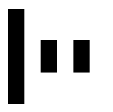 | 0 |
| 1 | `1` | 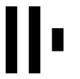 | 1 |
| 2 | `2` | 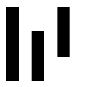 | 2 |
| 3 | `3` | 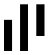 | 3 |
| 4 | `4` | 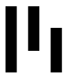 | 4 |
| 5 | `5` | 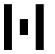 | 5 |
| 6 | `6` | 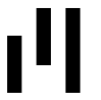 | 6 |
| 7 | `7` | 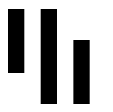 | 7 |
| 8 | `8` | 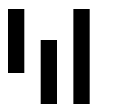 | 8 |
| 9 | `9` | 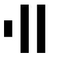 | 9 |
| ハイフン | `-` | 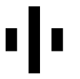 | 10 |
| CC1 | `a` | 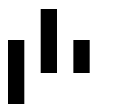 | 11 |
| CC2 | `b` | 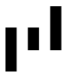 | 12 |
| CC3 | `c` | 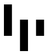 | 13 |
| CC4 | `d` | 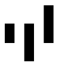 | 14 |
| CC5 | `e` | 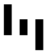 | 15 |
| CC6 | `f` | 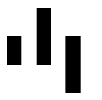 | 16 |
| CC7 | `g` | 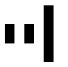 | 17 |
| CC8 | `h` | 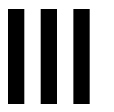 | 18 |
| スタート | `<` | 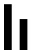 | — |
| ストップ | `>` |  | — |
| スタート（別入力） | `(` |  | — |
| ストップ（別入力） | `)` | 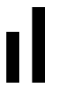 | — |

### 住所に含まれる英字

大文字1文字は、制御コードと数字の2コード分を描画します。たとえば大文字の D は a3、小文字の d はCC4です。

| 英字 | 同じ形になる入力 | バーの形 |
| --- | --- | --- |
| A | a0 | 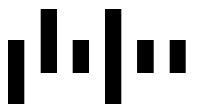 |
| B | a1 | 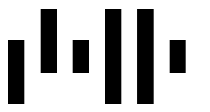 |
| C | a2 | 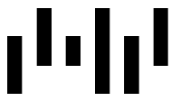 |
| D | a3 | 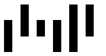 |
| E | a4 | 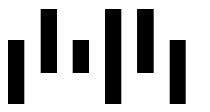 |
| F | a5 | 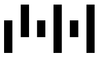 |
| G | a6 | 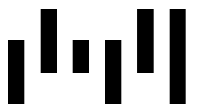 |
| H | a7 | 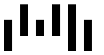 |
| I | a8 | 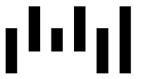 |
| J | a9 | 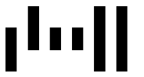 |
| K | b0 | 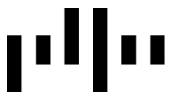 |
| L | b1 | 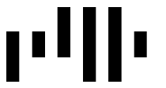 |
| M | b2 | 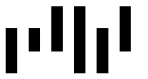 |
| N | b3 | 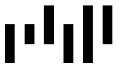 |
| O | b4 | 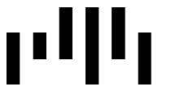 |
| P | b5 | 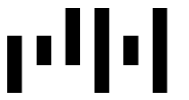 |
| Q | b6 | 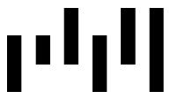 |
| R | b7 | 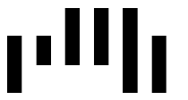 |
| S | b8 | 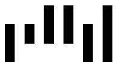 |
| T | b9 | 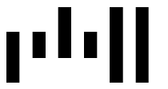 |
| U | c0 | 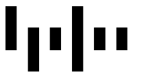 |
| V | c1 | 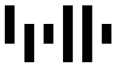 |
| W | c2 | 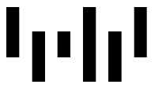 |
| X | c3 | 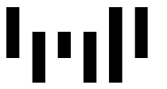 |
| Y | c4 | 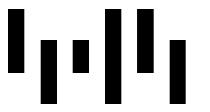 |
| Z | c5 | 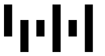 |

### バーコード全体の見本

入力文字列 `<10000131-3-2-503dddd9>`

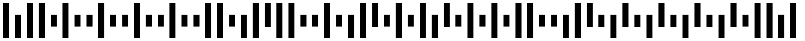

## 参考資料

- [日本郵便「カスタマバーコードの体系について」](https://www.post.japanpost.jp/service/search/zipcode/zipmanual/p11.html)
- [日本郵便「カスタマバーコードのフォーマットおよびけた数」](https://www.post.japanpost.jp/service/search/zipcode/zipmanual/p12.html)
- [日本郵便「印字位置」](https://www.post.japanpost.jp/service/search/zipcode/zipmanual/p13.html)
